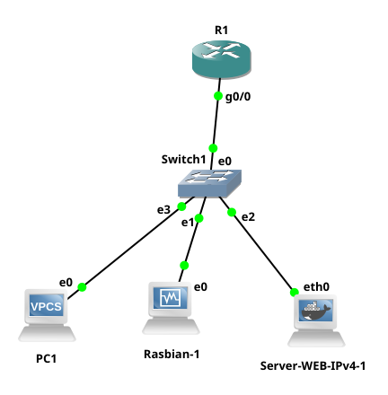

# PROYECTO ORIGEN - Laboratorio Web IPv4 para Capa 4

Este proyecto contiene un servidor web HTML estático sobre Nginx, diseñado como laboratorio para la unidad final de **Internet: Redes y Comunicaciones IP**.

El propósito pedagógico es observar en GNS3 la relación entre:

- Direccionamiento IPv4.
- Capa 4 del modelo OSI.
- TCP.
- Puertos y servicios.
- HTTP.
- Captura y análisis de tráfico con Wireshark.

> Este laboratorio no busca enseñar desarrollo web. El formulario es deliberadamente simple para facilitar la observación y análisis del tráfico generado entre cliente y servidor.

## Topología de referencia



Direccionamiento propuesto:

| Equipo | IPv4 | Función |
|---|---|---|
| R1 | `192.168.10.1/24` | Gateway |
| Raspbian | `192.168.10.11/24` | Cliente Linux |
| PC1 | `192.168.10.12/24` | Cliente VPCS |
| Servidor Web | `192.168.10.13/24` | Servidor HTTP |

## Estructura del proyecto

```text
IRYCIP-GNS3_Web_IPv4/
├── Dockerfile
├── docker-compose.yml
├── index.html
├── README.md
├── topologia-lab-ipv4.png
└── capturas/
    └── Captura desde 2026-11-03 17-42-41.png
```

## Construcción y ejecución con Docker Compose

Para construir la imagen e iniciar el contenedor:

```bash
docker compose up -d --build
```

Para comprobar el estado:

```bash
docker ps
```

La imagen generada para el laboratorio es:

```text
origen-web-ipv4:latest
```

El contenedor puede utilizarse localmente para validar el sitio antes de incorporarlo a GNS3.

## Acceso al contenedor desde la terminal

Antes de ingresar al contenedor es necesario identificar su **Container ID**:

```bash
docker ps
```

Ejemplo de salida:

```text
CONTAINER ID   IMAGE                    NAMES
1652c7ae2e65   origen-web-ipv4:latest   origen-web-ipv4
```

Una vez conocido el identificador, ingresar utilizando Bash:

```bash
docker exec -it ID_CONT bash
```

Ejemplo:

```bash
docker exec -it 1652c7ae2e65 bash
```

Dentro del contenedor se pueden utilizar herramientas de diagnóstico como:

```bash
ip -br addr
ip route
ip neigh
ss -lntp
ping
curl
traceroute
tcpdump
ps aux
```

## Uso en GNS3

La recomendación es importar la imagen `origen-web-ipv4:latest` como un **Docker container appliance** y conectar su interfaz `eth0` al switch del escenario.

Para el laboratorio, el servidor utiliza:

```text
IPv4:    192.168.10.13/24
Gateway: 192.168.10.1
Servicio: HTTP sobre TCP/80
```

Una configuración temporal desde el contenedor puede realizarse con:

```bash
ip addr add 192.168.10.13/24 dev eth0
ip link set eth0 up
ip route add default via 192.168.10.1
```

Validación:

```bash
ip -br addr
ip route
ping -c 4 192.168.10.1
ping -c 4 192.168.10.11
```

## Verificación del servicio HTTP

Dentro del servidor:

```bash
ss -lntp
```

Debe observarse Nginx escuchando en el puerto TCP 80.

Desde Raspbian:

```bash
curl http://192.168.10.13
```

También puede accederse desde un navegador mediante:

```text
http://192.168.10.13
```

## Captura y análisis con Wireshark

Filtros sugeridos:

```text
tcp.port == 80
```

```text
http
```

```text
http.request
```

Durante una conexión HTTP pueden observarse, entre otros elementos:

1. TCP SYN.
2. TCP SYN/ACK.
3. TCP ACK.
4. Solicitud HTTP.
5. Respuesta HTTP.

Esto permite relacionar directamente el establecimiento de una sesión TCP con el intercambio posterior de información de la aplicación.

## Evidencia de laboratorio

La carpeta `capturas/` almacena evidencias obtenidas durante la ejecución y análisis del escenario.


La captura permite evidenciar que, al utilizar HTTP sin cifrado, la información enviada por el formulario puede ser inspeccionada desde una herramienta de análisis de tráfico como Wireshark.

## Formulario HTTP: GET y POST

La versión inicial del laboratorio utiliza intencionalmente:

```html
<form action="/" method="GET">
```

Con `GET`, los parámetros enviados por el formulario aparecen directamente en la URL. Por ejemplo:

```text
GET /?usuario=daniel&password=origen123 HTTP/1.1
```

Esto facilita una primera demostración de cómo se transportan parámetros mediante HTTP, aunque hace muy evidente la exposición de las variables en la propia URL.

### Evolución recomendada: utilizar POST

Para una segunda versión del laboratorio resulta pedagógicamente más interesante utilizar:

```html
<form action="/" method="POST">
```

Con `POST`, el usuario y la contraseña ya no aparecen en la URL. Sin embargo, **si se continúa utilizando HTTP sin TLS, los datos siguen viajando sin cifrado y pueden observarse dentro del cuerpo de la solicitud HTTP mediante Wireshark**.

Esta comparación permite explicar una idea importante:

> Cambiar de GET a POST modifica la forma en que se envían los datos, pero no proporciona cifrado. La protección de la información en tránsito requiere HTTPS/TLS.

Por tanto, el laboratorio puede evolucionar pedagógicamente en tres etapas:

```text
GET sobre HTTP
      ↓
POST sobre HTTP
      ↓
POST sobre HTTPS/TLS
```

Esto permite comparar visibilidad de parámetros, transporte mediante TCP y protección de datos de aplicación.

> **Advertencia:** nunca deben utilizarse credenciales reales durante estas pruebas. El escenario tiene fines exclusivamente académicos y debe ejecutarse en un entorno controlado.

## Propósito del laboratorio

La idea central para los estudiantes es distinguir:

> **La dirección IP identifica el host; el puerto identifica el servicio.**

A partir del escenario se puede analizar:

```text
Cliente
   |
   | TCP/80
   v
Servidor Web
192.168.10.13
   |
   └── Nginx
          └── HTTP
```

También permite demostrar que disponer de conectividad IP no implica necesariamente que un servicio de aplicación esté disponible.

Por ejemplo:

```bash
ping 192.168.10.13
```

valida conectividad hacia el host, mientras que:

```bash
curl http://192.168.10.13
```

valida el acceso al servicio HTTP.

## Posibles extensiones

A partir de este escenario se puede evolucionar posteriormente hacia:

- HTTP GET vs HTTP POST.
- HTTP vs HTTPS/TLS.
- TCP vs UDP.
- Puertos y sockets.
- Análisis del three-way handshake de TCP.
- Nginx y Apache.
- CMS.
- Bases de datos.
- Captura de sesiones reales.
- Diagnóstico mediante `ss`, `tcpdump`, `curl` y Wireshark.

## PROYECTO ORIGEN

**Explorar · Comprender · Conectar · Diagnosticar**
